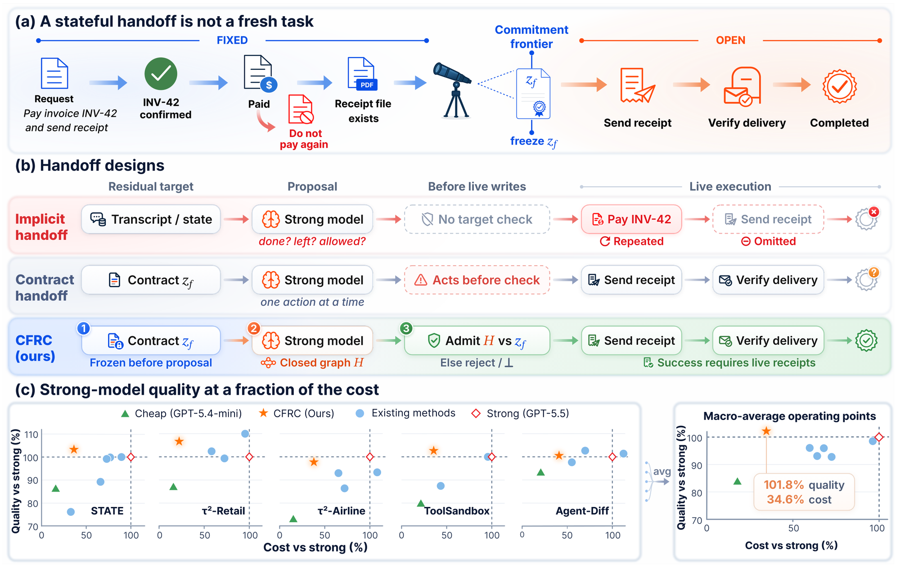
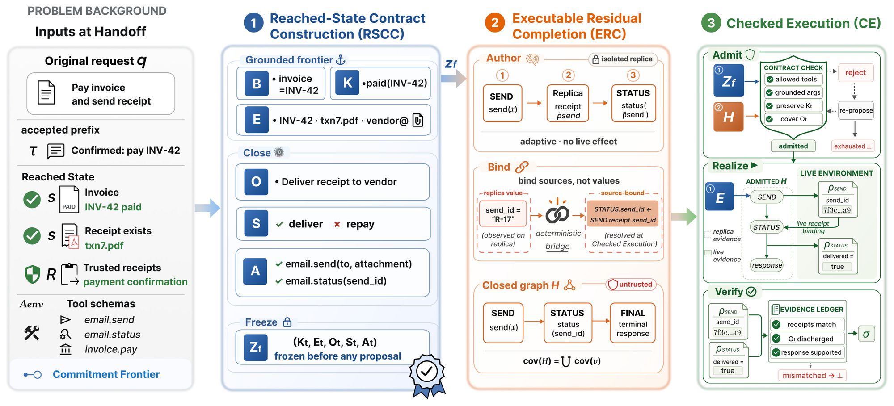

<div align="center">

# Do Not Restart: Residual Completion for Stateful Agent Handoffs

**Runzhi Deng · Yiming Zhong · Fang Zhao · Pan Zhou**

[](https://arxiv.org/abs/2609.13800)
[](pyproject.toml)
[](LICENSE)

</div>

<p align="center"></p>

**(a)** The cheap agent has already confirmed and paid invoice INV-42. Those
steps are fixed; only sending and verifying the receipt remain open.
**(b)** An implicit handoff may pay again and skip the receipt. A contract
handoff still acts before anything is checked. CFRC freezes the contract,
has the strong model write the whole remainder, and checks it before any live
write.
**(c)** Across five benchmarks, CFRC matches the strong model at 22–35% of its
cost.

Routing and cascades cut the cost of tool agents by moving control between
models. In a stateful task, though, the cheap model has already made choices
and changed the environment before the handoff. A successor that restarts may
repay an invoice or drop an unfinished step.

**Commitment-Frontier Residual Completion (CFRC)** treats the handoff as a
residual task. It freezes what the accepted prefix has committed, lets the
strong successor author only the remainder, and grants live tool authority
only after the whole remainder checks out.

## Method

<p align="center"></p>

Left to right: the handoff inputs (request, accepted prefix, reached state,
tools); **(1)** the frozen contract `Zf` of what is done and what is owed;
**(2)** the residual graph `H` the strong model authors on a replica;
**(3)** the check that admits `H`, runs it live, and verifies every obligation
against real receipts.

| Stage | What it does |
| --- | --- |
| **Reached-State Contract Construction** | Grounds the accepted prefix and freezes a residual contract: fixed bindings, open obligations, allowed actions. |
| **Executable Residual Completion** | The successor authors the remainder on an isolated replica; it is closed into an evidence-linked graph bound to the contract. |
| **Checked Execution** | Admits the graph only if it covers every obligation, then executes it live and discharges obligations with real receipts. Otherwise it fails closed. |

## Results

Task success (%) on five stateful tool-use benchmarks. Cost is the mean
per-surface ratio to the strong full-task agent.

| Method | STATE | τ²-Retail | τ²-Airline | ToolSandbox | Agent-Diff | Δ vs strong | Cost |
| --- | :-: | :-: | :-: | :-: | :-: | :-: | :-: |
| GPT-5.5 full task | 61.3 | 75.0 | 88.0 | 30.2 | 93.3 | — | 100% |
| **CFRC** (GPT-5.4-mini → GPT-5.5) | **63.3** | **80.0** | 86.0 | **31.0** | **93.8** | **+1.2** | **34.6%** |
| GPT-5.6 Sol full task | 60.7 | 80.0 | 90.0 | 30.2 | 88.9 | — | 100% |
| **CFRC** (GPT-5.6 Luna → Sol) | 60.7 | 76.5 | 86.8 | **33.3** | **96.9** | **+0.9** | **22.0%** |

Cross-provider pairs and the routing and cascade baselines are in the paper.

## Setup

```bash
git clone https://github.com/KomorebiWerts/CFRC.git && cd CFRC
uv sync
```

Place each benchmark checkout under `$PAPC_DATA_ROOT/benchmarks/` (default
`~/data/benchmarks/`): `tau2-bench-revised/repo`, `tau_bench/repo`,
`state_bench/repo`, `toolsandbox/repo`, and `agent_diff/repo`. Models are
reached through any OpenAI-compatible endpoint:

```bash
export OPENAI_API_BASE=https://your-endpoint/v1
export OPENAI_API_KEY=...
```

## Usage

```bash
papc-run                                    # list surfaces and modes
papc-run tau2 retail --model-pool-arm gpt54mini-gpt55-high --run-id demo            # provider-free preflight
papc-run tau2 retail --model-pool-arm gpt54mini-gpt55-high --run-id demo --execute  # real run
papc-run points                             # registered paper configurations
papc-run cost outputs/papc/<artifact>.json  # agent-side cost
```

| Benchmark | CFRC | Full-task anchor |
| --- | --- | --- |
| τ²-Retail | `tau2 retail` | `tau2 baseline` |
| τ²-Airline | `tau2 airline` | `tau2 airline-baseline` |
| STATE-Bench | `state method` → `state official-score` | official runner |
| ToolSandbox | `toolsandbox method` | `toolsandbox baseline` |
| Agent-Diff | `agent-diff method` | `agent-diff baseline` |

Every runner only writes a provider-free preflight unless `--execute` is given.
The baselines (RouteLLM-BERT, FrugalGPT, StepWise, MTRouter, AgServe-QAC) are
in `scripts/baselines/` and never import CFRC code.

## Repository layout

```
src/papc/certspec/      CFRC core: contract IR, compiler, ledgers, provider, costing
  tau2/ state_bench/ toolsandbox/        benchmark runtimes
src/papc/baselines/     routing and cascade baselines
scripts/                per-benchmark runners and readouts
src/papc/run.py         the papc-run entry point
```

## Citation

```bibtex
@article{deng2026donotrestart,
  title   = {Do Not Restart: Residual Completion for Stateful Agent Handoffs},
  author  = {Deng, Runzhi and Zhong, Yiming and Zhao, Fang and Zhou, Pan},
  journal = {arXiv preprint arXiv:2609.13800},
  year    = {2026}
}
```
